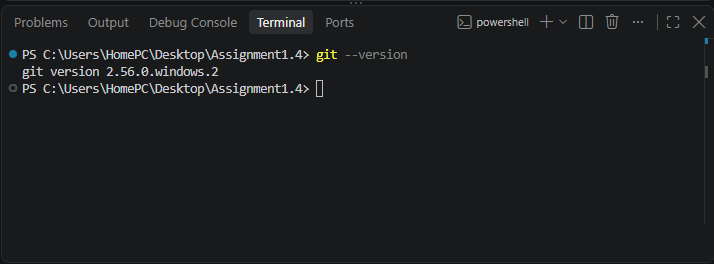
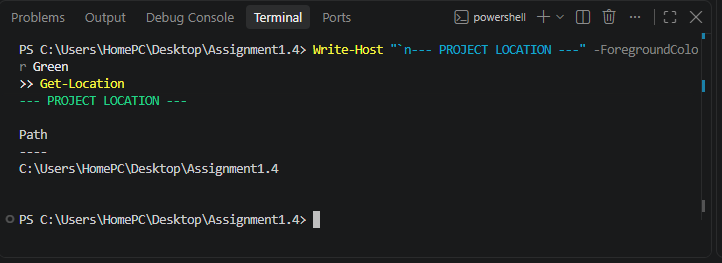
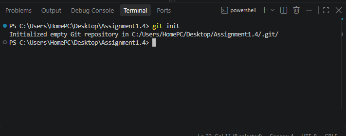
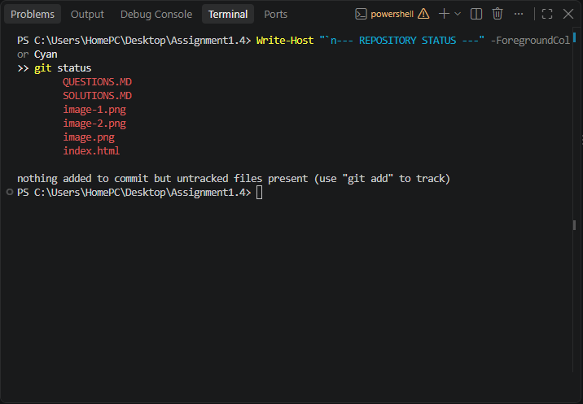
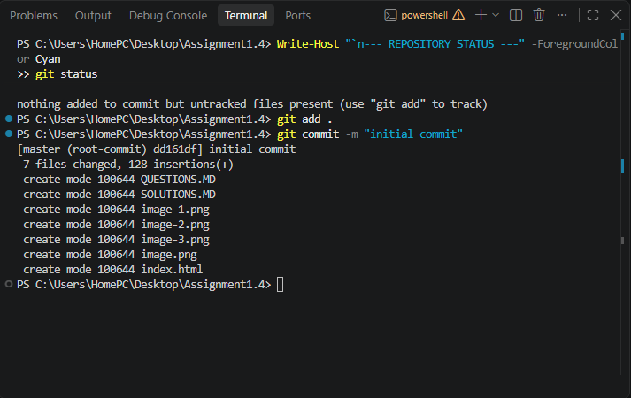
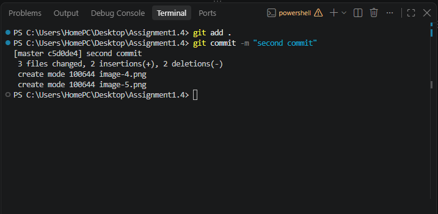
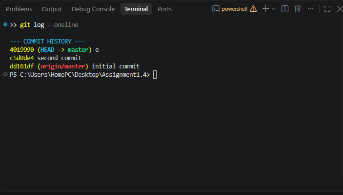
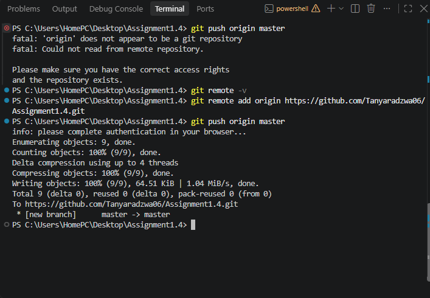

# Git Basics: Repository Initialization and Commit History

## Aim

To learn basic Git commands for initializing a repository, configuring user details, tracking files, committing changes, and viewing commit history.

## 1\. Check Git Version

```
git --version
```



## 2\. Check Project Location

```
Write-Host "`n--- PROJECT LOCATION ---" -ForegroundColor Green
Get-Location
```


## 3\. Initialize Git Repository

```
git init
```



## 4\. Configure Git Username and Email

```
$gitName = "Your Name"
$gitEmail = "your.email@example.com"

git config user.name $gitName
git config user.email $gitEmail
```

## Verify the configuration:

git config user.name
git config user.email


## 5\. Check Repository Status

```
Write-Host "`n--- REPOSITORY STATUS ---" -ForegroundColor Cyan
git status
```



## 6\. Stage and Commit Files

```
git add .
git commit -m "Initial commit"
```



## Git Second Commit



## 7\. View Commit History

```
Write-Host "`n--- COMMIT HISTORY ---" -ForegroundColor Cyan
git log --oneline
```


##  GIT PUSH



## Conclusion

In this practical, I learned how to check the Git version, initialize a local repository, configure Git username and email, check repository status, stage and commit files, and view commit history.

These commands provide the foundation for version control and collaborative software development using Git and GitHub.

